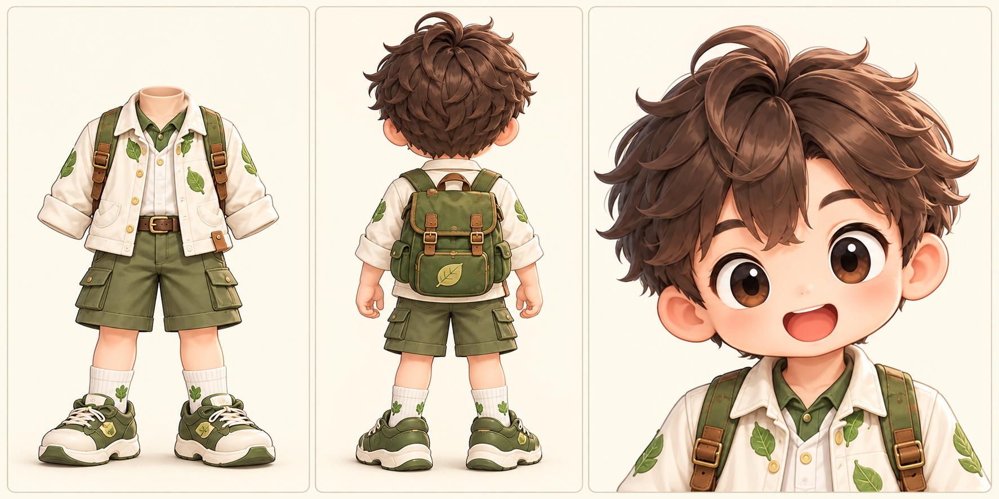
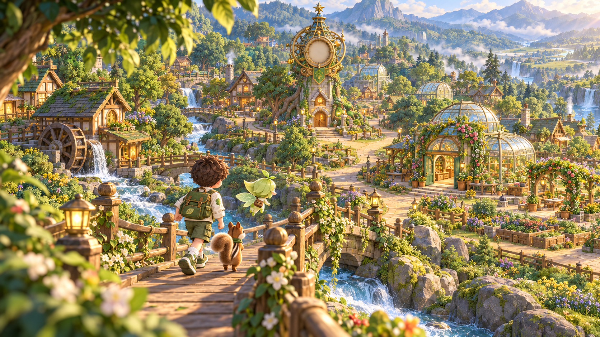
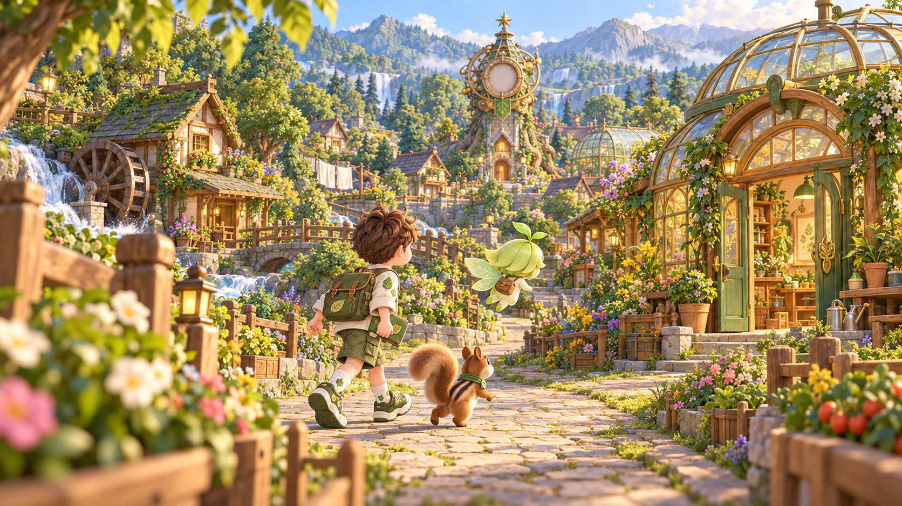
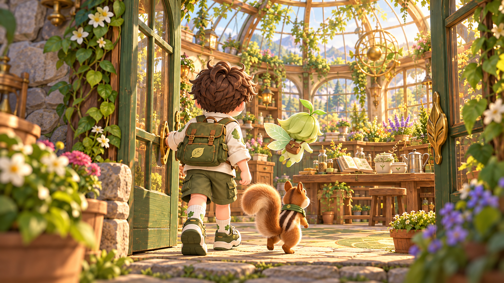
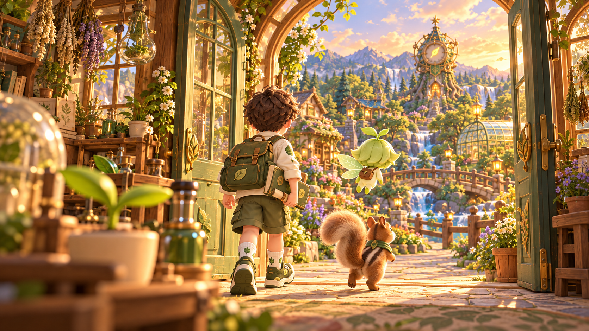
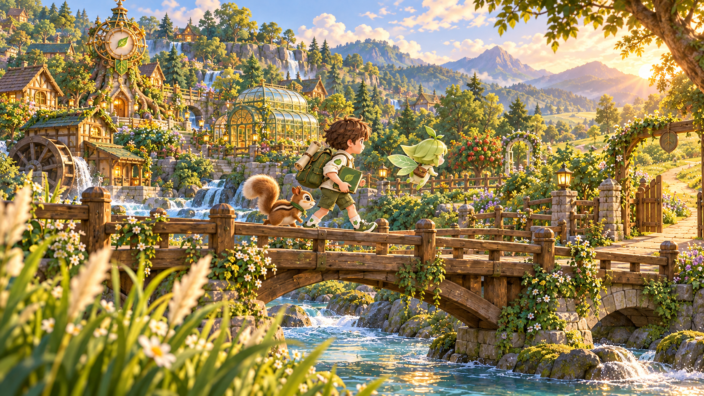
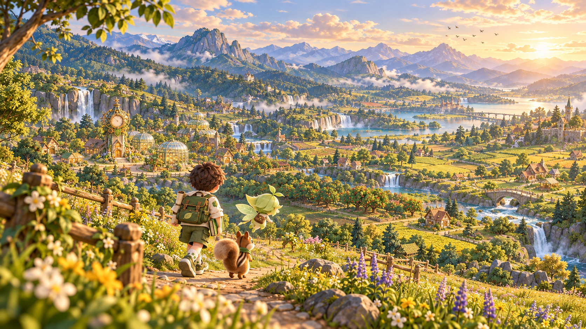

# 생명 시계 연구실 · 마을을 여행하는 인트로·아웃트로

**새 버전 · 2026-10-24 · 인트로 24초 / 아웃트로 30초 · 장면별 초기 이미지 6장 + 영상 프롬프트 6개**

이번에는 친구들이 **마을로 들어가고, 골목을 걷고, 연구소의 문턱을 넘고, 다시 마을 밖으로 나아가는 여정**이야. 전경의 울타리·문틀·갈대가 지나가고, 멀리 있는 시계탑과 산맥은 천천히 움직여서 이동감과 공간의 깊이를 만들어. 주택·물레방아·다리·과수원·강·먼 정착지까지 본편 밖의 세계를 보여 줘.

## 전체 흐름

**인트로 — 계곡의 마을 전경 → 골목을 따라 이동 → 연구소 입장**  
게임을 시작하기 전에 “어떤 세계에 왔고, 왜 탐험하며, 무엇을 해야 하는지”를 여행으로 보여 줘.

**아웃트로 — 발견을 품고 연구소 출발 → 살아난 마을과 다리 통과 → 더 넓은 세계**  
배운 내용은 짧은 자막으로 되짚고, 기록책과 말아 둔 기록증을 지닌 채 다음 관찰을 향해 떠나. 마지막은 보상 카드를 정면으로 보여 주는 구도가 아니라 마을이 큰 세계의 일부임을 드러내는 풍경이야.

## 캐릭터·공간 연결

지훈의 갈색 머리·잎무늬 크림 재킷·올리브 반바지·초록 배낭, 잎새의 잎 머리·날개·갈색 가방, 도토의 줄무늬 털·초록 목수건을 유지해. 세 캐릭터는 각각 한 명씩 등장해. 지훈 3패널 시트는 외형 참조용이며 장면의 시작 프레임으로 쓰지 않아.



마을 전경에서 보이는 **둥근 유리돔 연구소의 초록 아치문**을 다음 컷에서도 유지해. 인트로는 아침, 아웃트로는 따뜻한 늦은 오후야. 인트로 시계는 빈 얼굴, 아웃트로 시계는 되살아난 따뜻한 빛이 기준이야. 가까운 두 컷에서는 잎 모양 바늘이 보이고, 마지막 원경에서는 바늘을 강조하지 않고 시계 얼굴에 부드러운 빛이 흐르게 해. “시간이 멈췄다”는 세계관은 생명 기록이 끊겼다는 뜻이라 물과 바람, 친구들의 걸음까지 정지시키지 않아.

## 생성·편집 방법

1. 각 컷의 **새 이미지 한 장**을 image-to-video 시작 프레임으로 넣어. 아래 프롬프트 전체를 복사해. 캐릭터 시트는 도구에 별도 참조 슬롯이 있을 때만 추가해.
2. 인트로는 각 8초, 아웃트로는 각 10초로 만들어. 10초를 지원하지 않는 도구라면 8초로 생성한 뒤 **0.8배속으로 10초**를 맞춰. 정지 프레임 2초를 붙이지 않아.
3. 출력은 16:9, 편집 마스터는 1920×1080 / 24fps. 게임에 넣을 때는 1280×720 H.264 / yuv420p / faststart 배포본을 따로 만들어. 현재 이미지는 약 16:9인 1672×941 PNG야.
4. 각 컷은 **움직임 하나**를 끝까지 유지해. 이동은 카메라만 확대하는 효과가 아니라 실제 걸음·문턱 통과·위치 변화와 배경의 시차로 표현해. 종료 구도는 아래에 지정했고 대부분 다음 컷에 걸음을 이어 붙여.
5. 생성 영상에서는 글자·대사·음악을 끄고, 기존 음악과 한국어 자막을 편집에서 올려. 각 컷의 이동 방향과 발 디딤에 맞춰 하드컷을 쓰고 총길이 24초/30초를 유지해.

## 컷과 이동 설계

| 컷 | 구간 | 화면 크기 / 앵글 | 카메라 한 가지 | 실제 이동 |
|---|---|---|---|---|
| I-1 계곡 너머의 마을 | 00:00–00:08 | 롱샷 · 마을 전경 / 다리 뒤의 완만한 하이 앵글 | 전진 트래킹 | 다리 위에서 마을 초입까지 약 5m |
| I-2 마을 길을 따라 | 00:08–00:16 | 풀샷 · 이동하는 친구들과 골목 / 눈높이의 측후면 | 사이드 트래킹 | 골목에서 연구소 문앞까지 약 4m |
| I-3 연구소 문을 열며 | 00:16–00:24 | 풀샷 → 작업대가 보이는 미디엄 풀샷 / 지훈 어깨 뒤 눈높이 | 문을 통과하는 푸시 스루 | 문밖에서 연구소 작업대 앞까지 약 3m |
| O-1 발견을 품고 밖으로 | 00:00–00:10 | 풀샷 · 실내에서 마을로 / 지훈 뒤 눈높이 | 팔로우 트래킹 | 연구실 안에서 문밖 골목까지 약 5m |
| O-2 살아난 마을을 지나 | 00:10–00:20 | 롱샷 · 옆모습 다리 횡단 / 강변의 낮은 앵글 | 사이드 트래킹 | 다리 중간에서 마을 바깥 나무문까지 약 6m |
| O-3 마을 밖 더 넓은 세계 | 00:20–00:30 | 익스트림 롱샷 · 마을 밖 계곡 전체 / 언덕 위 하이 앵글 | 크레인 업 | 인물은 오솔길 4~5m 전진, 카메라는 약 8m 수직 상승 |

## 기존 음악·자막 편집

| 영상 | 기존 음악 | 원곡 사용 구간 | 페이드 |
|---|---|---|---|
| 인트로 24초 | The Garden Blooms · main-theme.mp3 | 00:00.00–00:24.00 | 시작 0.15초 / 끝 0.8초 |
| 아웃트로 30초 | Rising Motif · ending-theme.mp3 | 02:22.80–02:52.80 | 시작 0.7초 / 끝 1.5초 |

인트로의 경쾌한 탐험감은 골목을 걷는 속도에, 아웃트로의 따뜻한 여운은 마을을 떠나 계곡을 넓게 보여 주는 장면에 연결해. 이 음악 구간은 **초기 편집안**이야. 파일 길이와 긴 무음 부재만 확인했으며 실제 청취로 박자·프레이즈를 검수하지는 않았어. 마지막 편집 때 귀로 들으며 컷 경계를 소폭 맞춰 줘. 설계 문서의 92/80 BPM은 생성 목표값이며 실측값이 아니야.

자막은 최대 2줄, 하단 10% 안쪽에 두고 어두운 반투명 바탕으로 읽기 쉽게 해. 1080p 기준 약 48px에서 시작해 교실 화면으로 확인해. 보상은 손에 든 기록책과 배낭의 말린 기록증으로 표현하므로 화면을 가리는 정면 보상 패널을 넣지 않아.

## I-1 · 계곡 너머의 마을 · 00:00–00:08



**보이는 이동:** 다리 위에서 마을 초입까지 약 5m  
**전경·중경·배경:** 전경 나뭇잎·난간은 빠르게 뒤로 / 친구들과 다리는 중간 속도 / 시계탑·산맥은 느리게  
**끝 프레임:** 다리 끝에서 연구소 쪽 오른편 길로 접어드는 순간  
**다음 연결:** I-2의 오른쪽으로 걷는 방향에 맞춰 매치 컷

**자막**

- 00:00:00,400–00:00:03,900: 숲 너머에, / 생명의 시간을 지키는 마을이 있어.
- 00:00:04,200–00:00:07,700: 그런데 생명 시계가 / 멈춰 버렸어.

**복사할 영상 생성 프롬프트**

```text
LOCK: Animate the supplied keyframe, preserving its exact storybook rendering, village architecture and character identities. Exactly one Jihoon (brown tousled hair, cream leaf-print jacket, olive shorts and backpack), one Ipsae (green leaf hair, leaf wings, brown satchel) and one Doto (striped brown chipmunk, curled tail, green neckerchief). Preserve their scale, clothes and props. Do not make them face or perform for the viewer.
[CAMERA] 8 seconds, 16:9, wide establishing shot, gently elevated view from behind the group. ONE movement: forward tracking along the bridge for approximately 5 meters at a smooth walking pace. Keep the trio in the lower third and the blank-faced clock tower and round seed laboratory visible above them. Foreground leaves and nearby bridge posts pass across the edges quickly; houses shift more slowly and mountains barely move. Keep the lens fixed. End at the far end of the bridge with the group naturally entering the lane toward the laboratory on screen-right; movement continues through the last frame.
[SCENE] 0–2s: Jihoon is already walking forward across the bridge, Ipsae flies a little ahead and Doto trots beside him. 2–6s: they advance several clearly visible strides toward the village; the watermill, houses, glass domes and river open up around them. 6–8s: the trio begins following the lane to the right. The wheel slowly turns, water flows and leaves stir. The life-clock face remains blank: water and everyday village motion continue, while the missing life records are the story problem. No one stops to pose. Preserve the sunny morning.
[CONSTRAINTS] Keep a real, continuous walking journey with visible foot contact and changing location, not walking in place or a frozen picture with digital zoom. Stable anatomy, no sliding feet, teleporting, duplicated limbs or characters. No new text, titles, interface, reward cards, montage, transitions inside the shot, dialogue, sound or music. Keep the lower subtitle margin free of new important details.
```

## I-2 · 마을 길을 따라 · 00:08–00:16



**보이는 이동:** 골목에서 연구소 문앞까지 약 4m  
**전경·중경·배경:** 전경 화분·울타리는 왼쪽으로 빠르게 / 인물은 프레임 중앙 / 배경 시계탑은 천천히  
**끝 프레임:** 지훈의 앞발이 연구소 첫 문턱에 닿기 직전  
**다음 연결:** I-3의 문턱을 넘는 발에 동작 연결

**자막**

- 00:00:08,300–00:00:11,800: 나비는 어떻게 자랄까? / 씨앗은 언제 싹이 틀까?
- 00:00:12,100–00:00:15,700: 마을의 다섯 장소에 / 시간을 잇는 단서가 숨어 있어.

**복사할 영상 생성 프롬프트**

```text
LOCK: Animate the supplied keyframe, preserving its exact storybook rendering, village architecture and character identities. Exactly one Jihoon (brown tousled hair, cream leaf-print jacket, olive shorts and backpack), one Ipsae (green leaf hair, leaf wings, brown satchel) and one Doto (striped brown chipmunk, curled tail, green neckerchief). Preserve their scale, clothes and props. Do not make them face or perform for the viewer.
[CAMERA] 8 seconds, 16:9, full-body group shot at child eye level, three-quarter rear view as in the supplied frame. ONE movement: side tracking to the right, parallel to the lane, for about 4 meters. Keep the entire walking group in frame and allow the domed laboratory entrance to grow naturally in perspective. Close flower boxes and fence posts slide past the left frame edge, while the clock tower drifts slowly behind. Fixed lens; do not orbit or zoom. End beside the open green laboratory door, with Jihoon's leading foot just about to reach the first threshold.
[SCENE] 0–3s: Jihoon, Ipsae and Doto travel steadily from left toward right along the curving stone lane. Jihoon's book stays secure at his side; his free arm swings naturally. 3–6s: Ipsae flies to the open entrance, and Jihoon and Doto follow without stopping. 6–8s: the group reaches the doorstep. The watermill turns in the background and light moves softly through leaves. Keep the tower face blank. No one looks at the camera and no character appears suddenly.
[CONSTRAINTS] Keep a real, continuous walking journey with visible foot contact and changing location, not walking in place or a frozen picture with digital zoom. Stable anatomy, no sliding feet, teleporting, duplicated limbs or characters. No new text, titles, interface, reward cards, montage, transitions inside the shot, dialogue, sound or music. Keep the lower subtitle margin free of new important details.
```

## I-3 · 연구소 문을 열며 · 00:16–00:24



**보이는 이동:** 문밖에서 연구소 작업대 앞까지 약 3m  
**전경·중경·배경:** 문틀·화분이 양옆으로 크게 빠짐 / 친구들은 전진 / 연구실 선반·돔은 점차 넓어짐  
**끝 프레임:** 지훈은 왼쪽, 비교할 두 화분은 중앙에 보이는 탐구 시작 구도  
**다음 연결:** 마지막 작업대 구도에서 게임 시작 화면으로 0.2초 컷 또는 페이드

**자막**

- 00:00:16,200–00:00:20,000: 살펴보고, 조건을 바꿔 비교하고, / 변화를 기록해 줘.
- 00:00:20,200–00:00:23,800: 네가 찾은 증거로 / 숲의 시간을 다시 이어 보자!

**복사할 영상 생성 프롬프트**

```text
LOCK: Animate the supplied keyframe, preserving its exact storybook rendering, village architecture and character identities. Exactly one Jihoon (brown tousled hair, cream leaf-print jacket, olive shorts and backpack), one Ipsae (green leaf hair, leaf wings, brown satchel) and one Doto (striped brown chipmunk, curled tail, green neckerchief). Preserve their scale, clothes and props. Do not make them face or perform for the viewer.
[CAMERA] 8 seconds, 16:9. Full-body over-the-shoulder rear view at Jihoon's shoulder height. ONE movement: a smooth forward push-through following the trio through the existing open doorway and about 3 meters into the laboratory. No zoom or orbit. The near door jambs and potted plants sweep outward past both edges; the circular room opens in real perspective. Maintain a comfortable following distance and keep the two comparison pots ahead. End with Jihoon on the left third and the workbench with its two pots centered, ready for exploration; ease only during the final half-second.
[SCENE] 0–2s: Jihoon releases the already-open door and crosses the threshold, with Doto close beside him and Ipsae flying ahead. 2–6s: they walk into the room toward the workbench, taking visible, natural steps. 6–8s: Jihoon reaches the workbench and turns his attention to the two pots while Ipsae hovers by them and Doto arrives at his feet. Sunlight through the glass dome reveals jars, growing plants and observation tools. No instant plant growth, no magical experiment result and no additional props appear.
[CONSTRAINTS] Keep a real, continuous walking journey with visible foot contact and changing location, not walking in place or a frozen picture with digital zoom. Stable anatomy, no sliding feet, teleporting, duplicated limbs or characters. No new text, titles, interface, reward cards, montage, transitions inside the shot, dialogue, sound or music. Keep the lower subtitle margin free of new important details.
```

## O-1 · 발견을 품고 밖으로 · 00:00–00:10



**보이는 이동:** 연구실 안에서 문밖 골목까지 약 5m  
**전경·중경·배경:** 작업대·문틀이 빠르게 뒤로 / 인물은 중경 유지 / 문밖 마을이 계속 넓게 드러남  
**끝 프레임:** 친구들이 다리 쪽으로 오른쪽 방향을 잡는 순간  
**다음 연결:** O-2의 왼쪽→오른쪽 다리 횡단으로 연결

**자막**

- 00:00:00,300–00:00:04,700: 나비의 한살이를 살펴보고, / 씨앗이 싹트는 조건을 찾았지.
- 00:00:05,000–00:00:09,700: 물과 빛을 살펴 돌보고, / 계절 속 변화도 기록했어.

**복사할 영상 생성 프롬프트**

```text
LOCK: Animate the supplied keyframe, preserving its exact storybook rendering, village architecture and character identities. Exactly one Jihoon (brown tousled hair, cream leaf-print jacket, olive shorts and backpack), one Ipsae (green leaf hair, leaf wings, brown satchel) and one Doto (striped brown chipmunk, curled tail, green neckerchief). Preserve their scale, clothes and props. Do not make them face or perform for the viewer.
[CAMERA] 10 seconds, 16:9, full-body rear following shot at child eye level. ONE movement: follow tracking forward, about 5 meters, from inside the laboratory through the open door onto the village lane. Keep a fixed lens and stay behind the trio. The close seedling and table edge slide rapidly out of view, the door frame passes the camera, and the village opens beyond with increasing depth. End outside with the trio turning gently toward the bridge on screen-right. Keep their forward progress alive through the final frame, no long freeze.
[SCENE] 0–3s: Jihoon walks toward the doorway with his completed green field book and rolled certificate securely carried as shown; Ipsae leads and Doto follows at his side. 3–7s: the group crosses the threshold into golden afternoon light, with several clear steps and natural backpack movement. 7–10s: they follow the village lane toward the bridge. The restored clock has its glowing leaf hand, water flows and the garden moves in the breeze. The seedling left inside remains rooted in its pot. Their pride is expressed by purposeful relaxed movement, never by presenting a certificate to the camera.
[CONSTRAINTS] Keep a real, continuous walking journey with visible foot contact and changing location, not walking in place or a frozen picture with digital zoom. Stable anatomy, no sliding feet, teleporting, duplicated limbs or characters. No new text, titles, interface, reward cards, montage, transitions inside the shot, dialogue, sound or music. Keep the lower subtitle margin free of new important details.
```

## O-2 · 살아난 마을을 지나 · 00:10–00:20



**보이는 이동:** 다리 중간에서 마을 바깥 나무문까지 약 6m  
**전경·중경·배경:** 갈대·난간이 왼쪽으로 빠름 / 친구들은 중간 / 마을·시계탑은 느리게 뒤로  
**끝 프레임:** 오른쪽 나무문을 지나 바깥 오솔길에 첫발을 내딛는 순간  
**다음 연결:** O-3에서 같은 방향으로 이어지는 언덕길을 걷는 발에 매치 컷

**자막**

- 00:00:10,200–00:00:14,800: 겨울을 난 같은 나무와 / 씨앗에서 난 새 생명도 찾았어.
- 00:00:15,000–00:00:19,700: 네가 모은 증거가 / 마을의 시간을 다시 이었어.

**복사할 영상 생성 프롬프트**

```text
LOCK: Animate the supplied keyframe, preserving its exact storybook rendering, village architecture and character identities. Exactly one Jihoon (brown tousled hair, cream leaf-print jacket, olive shorts and backpack), one Ipsae (green leaf hair, leaf wings, brown satchel) and one Doto (striped brown chipmunk, curled tail, green neckerchief). Preserve their scale, clothes and props. Do not make them face or perform for the viewer.
[CAMERA] 10 seconds, 16:9. Wide full-body side view from low on the riverbank. ONE movement: side track to the right parallel to the bridge, smoothly following the walking group over about 6 meters. Keep Jihoon's side profile and all three companions visible. Nearby reeds and bridge railing pass left quickly, the bridge piers move at a medium pace and the village drifts slowly in the distance. No orbit, zoom or change of shot. End at the far bank with the trio passing the open wooden gate on screen-right and stepping onto the outward path.
[SCENE] 0–4s: the companions continue their left-to-right crossing with clear footfalls, natural arm swing and gentle backpack movement. 4–7s: they reach the far side while water ripples below, the watermill turns and garden leaves move. 7–10s: Ipsae passes the gate and Jihoon and Doto follow onto the meadow path. Keep the green book secure and the rolled certificate attached to the backpack. The restored clock remains behind them. They look along the route, not toward the viewer. Show physical travel across the bridge; do not loop their walking animation in one position.
[CONSTRAINTS] Keep a real, continuous walking journey with visible foot contact and changing location, not walking in place or a frozen picture with digital zoom. Stable anatomy, no sliding feet, teleporting, duplicated limbs or characters. No new text, titles, interface, reward cards, montage, transitions inside the shot, dialogue, sound or music. Keep the lower subtitle margin free of new important details.
```

## O-3 · 마을 밖 더 넓은 세계 · 00:20–00:30



**보이는 이동:** 인물은 오솔길 4~5m 전진, 카메라는 약 8m 수직 상승  
**전경·중경·배경:** 전경 풀·울타리가 아래로 크게 / 언덕·친구들은 중간 / 강·정착지·산맥은 넓게 펼쳐짐  
**끝 프레임:** 작아진 세 친구·계곡의 강·먼 마을·산맥을 한 프레임에 품은 구도  
**다음 연결:** 움직이는 풍경 위 마지막 자막 후 0.8초 페이드아웃

**자막**

- 00:00:20,200–00:00:24,800: 이제 너는 생명 탐험가! / 기록책과 탐험 기록증은 네 보상이야.
- 00:00:25,100–00:00:29,600: 다음 발견은 바로 우리 곁에 있어. / 주변의 생명을 관찰해 보자!

**복사할 영상 생성 프롬프트**

```text
LOCK: Animate the supplied keyframe, preserving its exact storybook rendering, village architecture and character identities. Exactly one Jihoon (brown tousled hair, cream leaf-print jacket, olive shorts and backpack), one Ipsae (green leaf hair, leaf wings, brown satchel) and one Doto (striped brown chipmunk, curled tail, green neckerchief). Preserve their scale, clothes and props. Do not make them face or perform for the viewer.
[CAMERA] 10 seconds, 16:9, extreme-wide landscape shot from the hillside. ONE movement: a smooth vertical crane up by approximately 8 meters, with a fixed lens and a constant gently downward camera angle. No backward dolly, zoom, pan or orbit. Nearby grasses and the low fence drop below frame rapidly; the small travelling trio stays in the lower third, while the river, orchards, distant homes and mountains unfold in depth. End at the higher viewpoint with the full valley visible and the trio still progressing along the path. Only a very gentle deceleration during the final second, no posed freeze.
[SCENE] 0–3s: Jihoon, Ipsae and Doto continue away along the winding meadow path, taking natural visible steps; nobody turns around. 3–7s: as the camera rises, the familiar village becomes one part of a much larger living world: fields, orchards, flowing rivers and distant homes. 7–10s: the group advances farther along the path, small against the vast landscape, while clouds drift gently and a few distant birds cross the sky. A soft warm glimmer gradually flows across the existing distant clock face. At this wide distance its hand does not need to be distinguishable; do not invent a new hand, change the face geometry or enlarge the clock. Preserve Jihoon's green book, backpack and secured rolled certificate. The mood is an open-ended discovery journey, not a victory poster.
[CONSTRAINTS] Keep a real, continuous walking journey with visible foot contact and changing location, not walking in place or a frozen picture with digital zoom. Stable anatomy, no sliding feet, teleporting, duplicated limbs or characters. No new text, titles, interface, reward cards, montage, transitions inside the shot, dialogue, sound or music. Keep the lower subtitle margin free of new important details.
```
## 산출물·검증 범위

- [제작 캔버스](https://chatgpt.com/space/page_460460032f588191b5ef86b6e3b246d6)
- [영상 프롬프트와 이동·자막 원자료](production.json)
- [초기 이미지 생성 프롬프트](image-prompts.json)
- [인트로 자막](intro-ko.srt) · [아웃트로 자막](outro-ko.srt)
- [생성 파일·치수·해시](asset-manifest.json)
- [이전 정적 버전](../20261024/README.md) — 보존용

내장 OpenAI image_gen으로 **새 이미지 6장을 실제 생성**했고, 장면·캐릭터·보행 자세·시점·목적지·전경/중경/배경을 육안 확인했어. 원본 PNG를 D: 프로젝트에 복사하고 해시를 대조했어. 기존 이미지와 문서는 덮어쓰지 않았어. 실제 동영상 생성·보행 안정성·컷 접합·음악 청취 검수는 아직 수행하지 않았어. 게임 실행 코드는 바꾸지 않았어.

