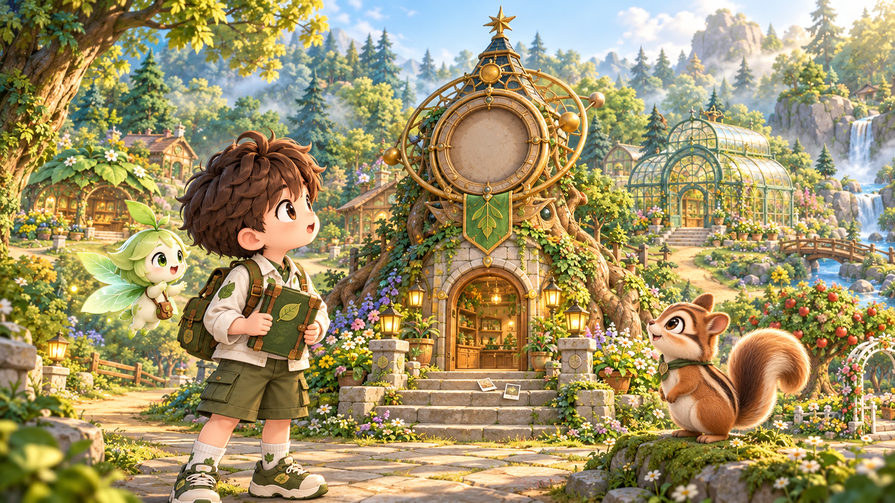
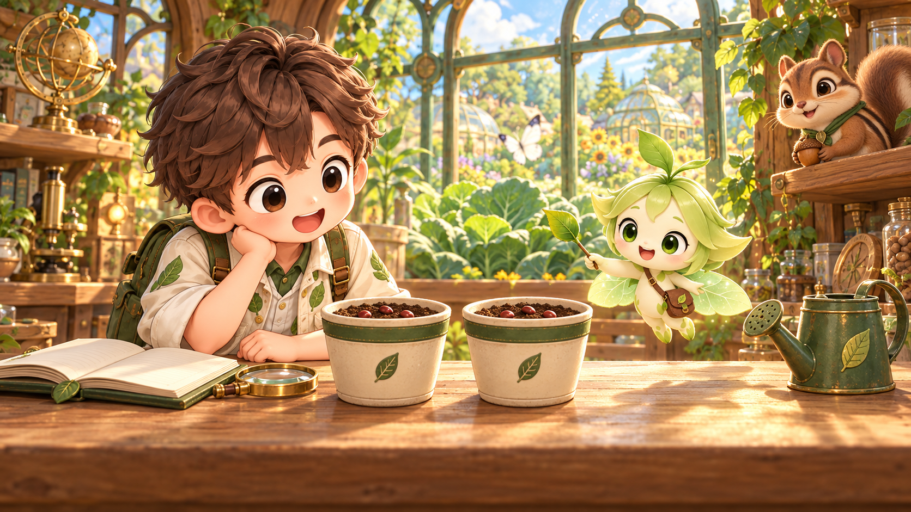
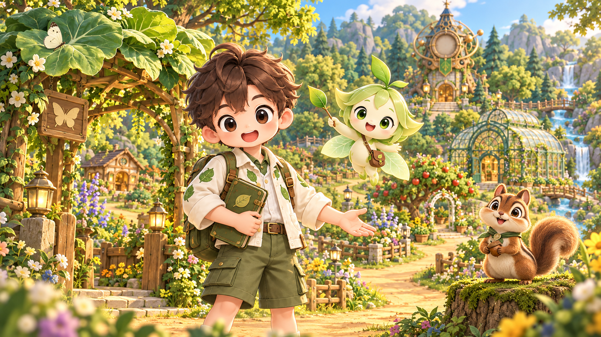
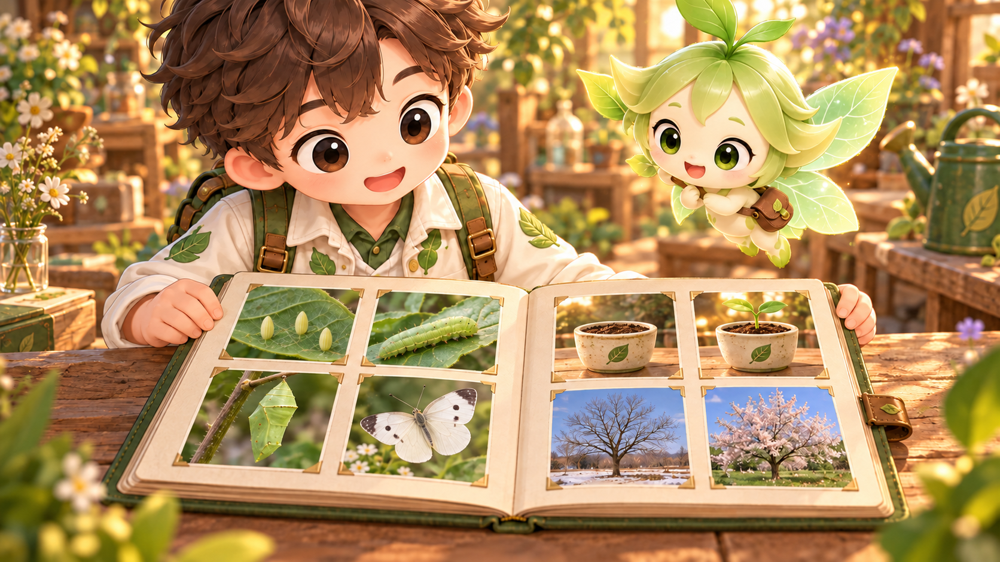
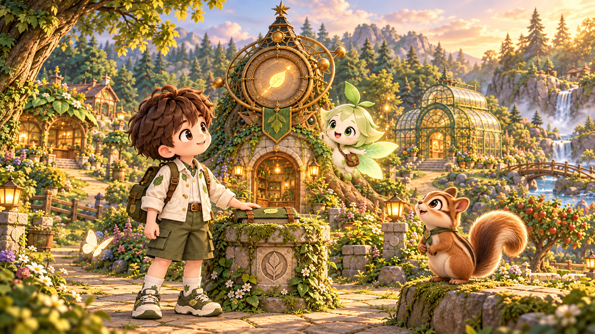
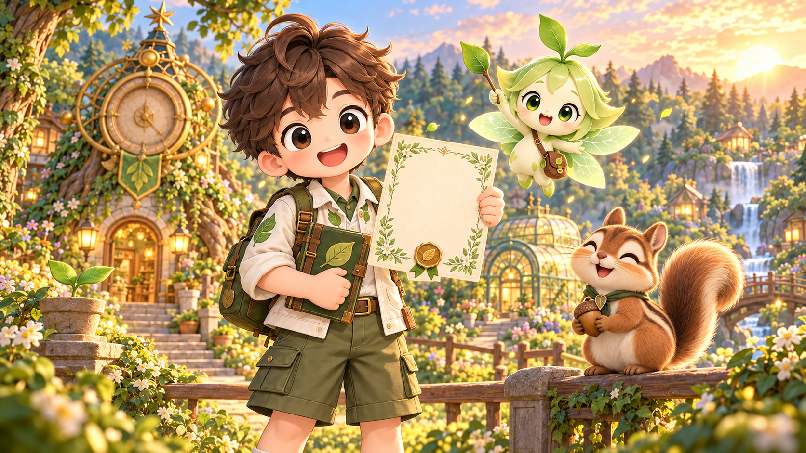

# 생명 시계 연구실 · 인트로·파이널 영상 제작안

기존에 생성된 기준 이미지 6장을 복구했어. **인트로 24초(8초 × 3컷), 파이널 30초(10초 × 3컷), 16:9** 구성이야. 실제 영상은 아직 생성하지 않았어. 각 이미지로 별도 image-to-video 클립을 만든 뒤 이어 붙이면 돼.

## 세계관과 캐릭터 고정

숲의 다섯 장소는 **나비의 숲 → 씨앗 연구소 → 햇살 온실 → 사계절 정원 → 생명 시계탑**이야. 학생이 남긴 관찰·비교 실험·돌봄·계절 기록으로 끊어진 시간을 잇는 이야기야. 인트로는 질문과 출발, 파이널은 배운 내용·숲의 회복·보상으로 마무리해.

- **지훈:** 갈색 곱슬 머리와 큰 갈색 눈, 잎무늬 크림색 재킷, 올리브색 반바지, 초록 배낭과 운동화.
- **잎새:** 연두색 잎 머리, 머리 위 새싹, 투명한 잎 날개, 갈색 크로스백, 잎 지팡이.
- **도토:** 갈색 줄무늬 다람쥐, 크림색 배, 큰 말린 꼬리, 초록 목수건과 잎 장식.
- 장면에 없는 캐릭터를 추가하지 않아. 파이널 1컷은 지훈·잎새만 나와.
- 지훈 시트는 **머리 없는 전신 정면 / 전신 후면 / 얼굴 클로즈업** 3패널이야. 영상의 시작 프레임은 각 장면 이미지로 지정하고, 캐릭터 시트는 별도 외형 참조 슬롯이 있을 때만 추가해. 시트 자체를 첫 프레임으로 넣지 마.


## 먼저 알아둘 제작 설정

장면별 이미지를 시작 프레임으로 넣고 아래 프롬프트 전체를 복사해. **카메라 움직임은 컷당 하나**이며, 각 프롬프트에 끝 구도를 지정했어. 출력은 16:9, 최종 편집은 1920×1080 / 24fps를 권장해. 원본 6장은 약 16:9(1672×941) PNG라서 얼굴·손·기록책이 잘리지 않게 맞춰 줘.

툴에서 10초를 지원하면 파이널을 컷당 10초로 생성해. 8초까지만 지원하면 **8초 생성 + 마지막 프레임 2초 정지**로 각 10초를 맞춰도 돼. 한 번에 24초·30초 전체를 생성하지 않아. 자막과 음악은 편집 단계에서 올리고, 생성 영상에는 글자·대사·음악을 넣지 않아.

사진책은 학습 내용을 보여 주는 **예시 기록**이야. 학생이 게임에서 실제로 남긴 기록과 같다고 표시하지 않아. 기록증은 빈 종이 상태를 유지하고, 필요하면 편집기에서 “생명 탐험가”만 덧붙여.

## 컷 구성

| 컷 | 구간 | 길이 | 크기 | 앵글 | 움직임 | 목적 |
|---|---|---:|---|---|---|---|
| I-1 · 멈춘 생명 시계 | 00:00–00:08 | 8초 | 롱샷 | 눈높이 | 느린 달리 인 | 멈춘 시계와 흩어진 기록을 보고 탐험 이유를 이해해. |
| I-2 · 작은 씨앗의 질문 | 00:08–00:16 | 8초 | 미디엄 샷 | 테이블 높이의 눈높이 | 정지 | 직접 관찰하고 조건을 비교해 보고 싶은 질문을 던져. |
| I-3 · 함께 탐험하자 | 00:16–00:24 | 8초 | 미디엄 풀샷 | 눈높이 | 느린 달리 인 | 다섯 장소의 증거를 모으는 게임 목표와 출발 의지를 연결해. |
| F-1 · 우리가 알아낸 것 | 00:00–00:10 | 10초 | 미디엄 클로즈업 → 책 인서트에 가까운 구도 | 약한 하이 앵글 | 아주 느린 달리 인 | 나비의 한살이와 조건 비교·돌봄을 기록으로 되짚어. |
| F-2 · 증거로 되살린 숲 | 00:10–00:20 | 10초 | 풀샷 → 롱샷 | 눈높이에서 완만한 하이 앵글 | 느린 크레인 업 | 계절과 다음 세대의 차이를 되짚고 내 탐구가 숲을 회복시켰음을 보여 줘. |
| F-3 · 생명 탐험가의 약속 | 00:20–00:30 | 10초 | 미디엄 풀샷 | 눈높이 | 정지 | 기록책·탐험 기록증 보상과 현실의 관찰로 이어지는 성취감을 남겨. |

## 기존 음악 편집표

새 음악 생성 없이 프로젝트에 들어 있는 두 파일을 사용해. 아래 큐는 **초기 편집안**이야. 파일 길이와 선택 구간의 긴 무음 부재는 확인했지만, 실제 청취로 박자와 프레이즈까지 검수하지는 않았어. 마지막 편집에서 귀로 들으며 컷 경계를 미세 조정해 줘.

| 영상 | 실제 음악 | 원곡 구간 | 영상 컷과 대응 | 페이드 |
|---|---|---|---|---|
| 인트로 24초 | The Garden Blooms · main-theme.mp3 (67.88초) | 00:00.00–00:24.00 | 0–8 / 8–16 / 16–24초 | 시작 0.15초, 끝 0.8초 |
| 파이널 30초 | Rising Motif · ending-theme.mp3 (172.8초) | 02:22.80–02:52.80 | 원곡 142.8–152.8 / 152.8–162.8 / 162.8–172.8초 | 시작 0.7초, 끝 1.5초 |

메인 음악의 호기심과 가벼운 진행감에 맞춰 “문제 → 질문 → 출발”을 배치했어. 엔딩은 기존 곡의 마지막 30초를 써서 “되짚기 → 회복 → 기록증과 여운”으로 닫는 안이야. 설계 문서의 BPM 92/80은 **생성 프롬프트의 목표값**이며, 실제 음원의 측정값으로 취급하지 않아. 추가 효과음 없이 음악과 자막만으로도 완결되게 구성했어.

자막은 화면 하단 10% 안쪽, 최대 2줄, 흰색 굵은 글씨와 어두운 반투명 바탕을 사용해. 1080p 기준 약 48px를 출발점으로 두고 교실 화면에서 읽히는지 확인해. 컷 사이에는 기본 하드컷을 쓰고, 24초/30초 총길이를 유지해.

## I-1 · 멈춘 생명 시계 · 00:00–00:08



**자막**

- 00:00:00,400–00:00:03,500: 숲의 생명 시계가 멈췄어.
- 00:00:03,800–00:00:07,600: 나비와 씨앗의 시간이 / 기록에서 흩어졌대.

**영상 생성 프롬프트 · 그대로 복사**

```text
LOCK: Use the supplied start image as the composition and identity reference. Preserve Jihoon's exact face, brown hair, cream leaf-pattern jacket, olive shorts, green backpack and shoes; preserve Ipsae's pale-green leaf hair, leaf wings and brown satchel; preserve Doto's striped brown fur, curled tail and green neckerchief. Exactly one boy, one leaf spirit and one chipmunk. No duplicate characters.
[CAMERA] 8 seconds, 16:9. Eye-level long shot. One movement only: a slow, straight dolly in by roughly 8%. Keep the empty clock face above the trio and all three characters readable. Ease to a complete stop by 6.5 seconds and hold the final composition for 1.5 seconds.
[SCENE] A warm, richly illustrated storybook forest research village, exactly as in the reference. The life clock has stopped and its face is blank. Jihoon looks up with curious concern, holding his green record book close. Ipsae gently hovers beside him; Doto tilts his head toward the clock. Only a few leaves stir. The scattered photographs stay on the steps. The environment is inviting, not scary. Maintain the existing sunlight and handcrafted botanical architecture.
[CONSTRAINTS] Keep the clock blank and motionless throughout this opening. No sudden restoration, new characters, scene transition, montage, camera shake, text, subtitles, logos, speech or music. Preserve anatomy and clothing. Leave the lower subtitle area readable.
```

## I-2 · 작은 씨앗의 질문 · 00:08–00:16



**자막**

- 00:00:08,300–00:00:11,700: 같은 씨앗도 / 자라는 모습이 달라질까?
- 00:00:12–00:00:15,600: 직접 살펴보고, / 조건을 바꿔 비교해 보자!

**영상 생성 프롬프트 · 그대로 복사**

```text
LOCK: Use the supplied start image. Keep the identical Jihoon, Ipsae and Doto, their faces, proportions, clothing and colors. Exactly one boy, one leaf spirit and one chipmunk in their existing places. Keep both matching seed pots and the same number of visible seeds in each.
[CAMERA] 8 seconds, 16:9. Medium shot from eye level at the tabletop. Static camera; no zoom, pan or focus pull. Preserve both pots in the lower center and Jihoon's and Ipsae's faces above them. End on the same stable composition, with the last 1.5 seconds settled.
[SCENE] Inside the sunlit seed research room, Jihoon studies the two matching pots with a curious smile. Ipsae makes one small inviting gesture with the leaf wand toward the pots. Doto blinks once from the existing shelf. Jihoon gives a slight thoughtful nod. Soft light glimmers on the brass magnifier and watering can. Keep the notebook, soil, pots, equipment and greenhouse background in place.
[CONSTRAINTS] This is a question before an experiment: no automatic germination, growing plants, pouring water, changing soil or invented experiment results. Do not transform seeds into magical objects. No added text, subtitles, labels, speech, music, additional characters or shot changes.
```

## I-3 · 함께 탐험하자 · 00:16–00:24



**자막**

- 00:00:16,200–00:00:19,700: 다섯 장소에서 / 생명의 단서를 모아 줘.
- 00:00:20–00:00:23,700: 네가 찾은 증거로 / 숲의 시간을 다시 이어 보자!

**영상 생성 프롬프트 · 그대로 복사**

```text
LOCK: Start from the supplied image. Preserve Jihoon's existing identity, leaf-pattern jacket, olive shorts, backpack and green record book. Preserve Ipsae's leaf wings and satchel and Doto's striped fur and neckerchief. Exactly these three characters, once each.
[CAMERA] 8 seconds, 16:9. Eye-level medium-full shot. One movement: a very slow straight dolly in, about 6%, keeping Jihoon's inviting hand, the trio and the forest paths visible. Stop by 6 seconds; hold the welcoming composition for the last 2 seconds.
[SCENE] At the butterfly-forest entrance, Jihoon faces the viewer with an open welcoming palm and his record book held safely against his body. He makes one subtle encouraging nod. Ipsae gives a tiny friendly wave with the leaf wand. Doto lifts his chin with eager curiosity while holding the acorn. The familiar clock tower, greenhouse and branching paths remain in the background. Gentle leaves and warm sunlight suggest an adventure about to begin.
[CONSTRAINTS] Keep the clock un-restored. No walking out of frame, exaggerated bouncing, duplicate fingers, new characters, reshaped buildings, new props, montage, subtitles, text, speech or music. Finish with space for an editor-added start transition.
```

## F-1 · 우리가 알아낸 것 · 00:00–00:10



**자막**

- 00:00:00,300–00:00:04,800: 알, 애벌레, 번데기를 거쳐 / 나비가 되었지.
- 00:00:05,100–00:00:09,700: 조건을 하나씩 바꿔 비교하고, / 물과 빛에 맞게 돌봤지.

**영상 생성 프롬프트 · 그대로 복사**

```text
LOCK: Use the supplied start image exactly. Keep one Jihoon and one Ipsae only; Doto is outside this shot and must not be added. Preserve both characters' identities and clothing. Preserve every photograph, page edge and hand position in the open evidence book.
[CAMERA] 10 seconds, 16:9. Medium close-up from a gentle high angle, oriented toward the open book. One movement only: a very slow straight dolly in by 5%, without tilting or zooming. Keep all eight photographs inside the frame and the characters' eyes visible above the book. Stop by 7 seconds and hold the final frame for 3 seconds.
[SCENE] In the warm research room, Jihoon proudly presents a completed example evidence book while Ipsae smiles with quiet delight. Jihoon breathes naturally and blinks once, keeping his hands and the book steady. Ipsae hovers subtly. The book shows four separate butterfly stages on the left—elongated upright eggs, caterpillar, chrysalis and adult white butterfly—and plant and seasonal observations on the right. Maintain the exact printed photographs from the reference.
[CONSTRAINTS] Printed evidence remains completely still. No photographs animating, no transformation between species, no page turning, no new symbols or labels, no duplicated hands, no lip-sync, captions, music or scene cuts. Keep the lower margin usable for subtitles added in editing.
```

## F-2 · 증거로 되살린 숲 · 00:10–00:20



**자막**

- 00:00:10,200–00:00:14,700: 겨울을 난 나무와 / 씨앗에서 난 새 생명도 찾았어.
- 00:00:15–00:00:19,700: 네 관찰과 실험으로 / 숲의 시간이 다시 이어졌어!

**영상 생성 프롬프트 · 그대로 복사**

```text
LOCK: Use the supplied start image, preserving the same Jihoon, Ipsae and Doto and every costume detail. Exactly one of each character. Keep the same life-clock tower, closed green evidence book on the stone pedestal, greenhouse, paths and waterfall.
[CAMERA] 10 seconds, 16:9. Begin at eye level in a full shot. One movement only: a slow vertical crane up, maintaining a level horizon and gently revealing more of the same village. Do not orbit, pan, zoom or move backward. Keep the clock face and the trio visible. Stop rising by 7 seconds and hold for 3 seconds.
[SCENE] The completed evidence book rests on the pedestal. Jihoon looks from the book toward the restored life clock with a proud, relieved smile. Ipsae hovers beside him and Doto watches from the stone ledge. The existing golden leaf-shaped clock hand glows softly and makes only a tiny natural movement. Warm light gently spreads through the existing lamps; leaves move in a mild breeze. Celebrate careful observation and evidence, with a tender sense of achievement.
[CONSTRAINTS] No new buildings or characters, no exploding light, no rapid time lapse, no plants transforming into animals, no changed book or costume, no oversized new clock hands, text, subtitles, dialogue, music or shot changes.
```

## F-3 · 생명 탐험가의 약속 · 00:20–00:30



**자막**

- 00:00:20,200–00:00:24,800: 축하해, 생명 탐험가! / 기록책과 탐험 기록증을 받았어.
- 00:00:25,100–00:00:29,600: 이제 우리 주변의 생명도 / 직접 관찰해 보자!

**영상 생성 프롬프트 · 그대로 복사**

```text
LOCK: Use the supplied start image. Preserve one Jihoon, one Ipsae and one Doto, the exact faces, leaf clothing, backpack, satchel, striped fur and green neckerchief. Preserve Jihoon's green book and the blank cream certificate with its gold leaf seal.
[CAMERA] 10 seconds, 16:9. Eye-level medium-full group shot. Static camera for the entire shot; no zoom, pan, tilt or orbit. Keep the certificate fully readable as a blank shape and all three faces unobstructed. Settle the characters by 7 seconds and hold a calm, proud final composition for 3 seconds.
[SCENE] Golden evening light falls across the restored forest village. Jihoon proudly presents the certificate to the viewer and gives one gentle nod while keeping it steady. Ipsae makes a small celebratory lift of the leaf wand; Doto closes his eyes in a happy smile and hugs the acorn. A few tiny golden leaves drift softly in the background. The mood is warm, earned and playful, leaving the viewer ready to observe real living things.
[CONSTRAINTS] The certificate stays completely blank for later editor-added Korean lettering. No generated letters or student names. Do not add trophies, fireworks, coins, new characters or extra fingers. No loud jumping, new scene, spoken dialogue, subtitles or music. Preserve the final pose for the closing fade.
```
## 파일과 확인 결과

- [기존 제작 캔버스](https://chatgpt.com/space/page_460460032f588191b5ef86b6e3b246d6)
- [전체 구조화 프롬프트](production.json)
- [인트로 자막](intro/intro-ko.srt) · [파이널 자막](finale/finale-ko.srt)
- [원본 복구·치수·해시 기록](asset-manifest.json)
- [메인 음악](../../../assets/audio/music/main-theme.mp3) · [엔딩 음악](../../../assets/audio/music/ending-theme.mp3)

이전 내장 image_gen 출력 6장을 새로 생성하지 않고 복구했으며, D: 저장본과 원본의 SHA-256 일치를 확인했어. 최종 관찰책은 길쭉한 알로 수정된 버전을 사용했어. 실제 영상 생성·재생 검수, 음악 청취·박자 검수는 남아 있어. 게임 실행 코드는 변경하지 않았어.

