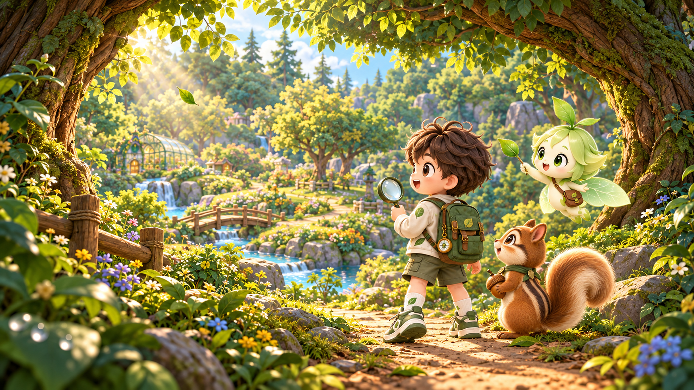
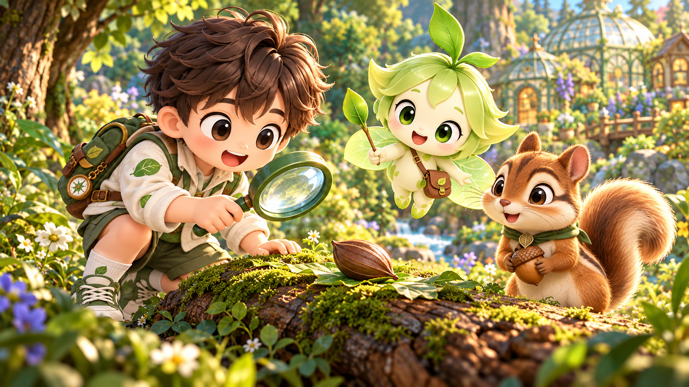
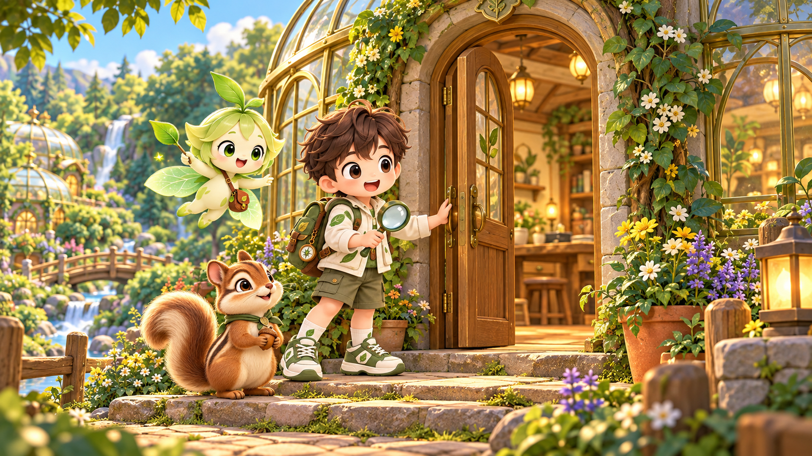
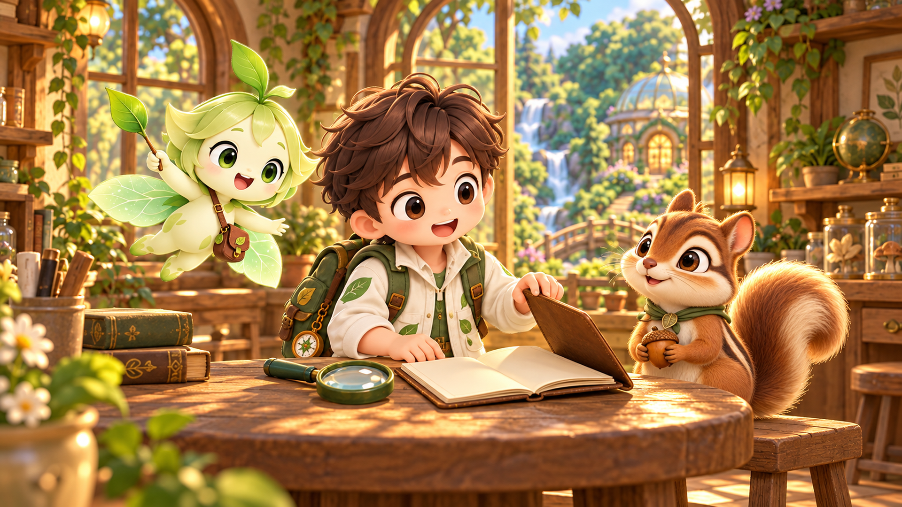
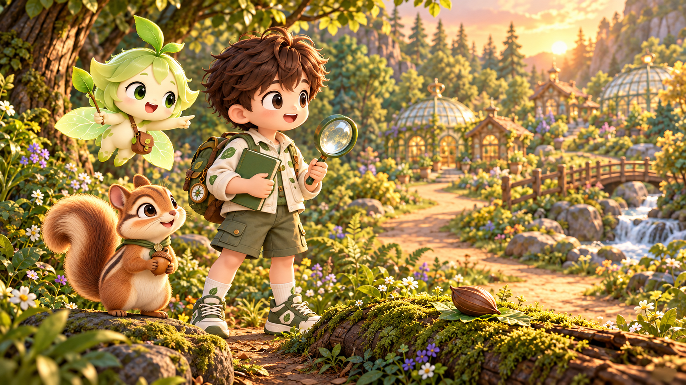
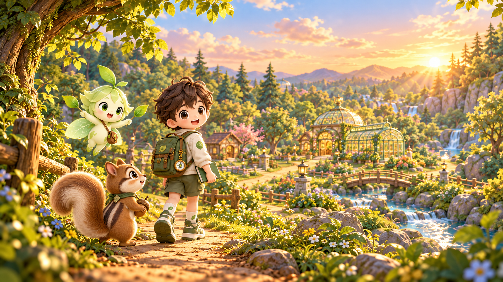

# 생명 시계 연구실 · 캐릭터 인트로 / 아웃트로 제작 자료

2026-10-27 · 마지막 캐릭터 OG와 같은 캐릭터·숲 화풍. 생명 시계의 결론이나 학습 정답을 미리 보여 주지 않는 구성.

## 파일과 기본 설정

- 인트로 3컷 × 6초 = **18초**. 아웃트로 3컷 × 6초 = **18초**. 총 6클립, **36초**.
- 참조 이미지 6장: **1920×1080, 16:9, 불투명 PNG**. 각 이미지가 해당 컷의 **시작 프레임**이다.
- 범용 이미지→영상 프롬프트. 생성 툴은 지정하지 않았다. 영상 생성 시 16:9 / 6초 / 24fps를 기본값으로 사용한다.
- 컷마다 아래 영문 블록 전체를 복사하고, 해당 시작 이미지 **1장**을 넣는다. 여러 장면을 한 번에 같은 영상 입력에 넣지 않는다.
- 캐릭터 참조 슬롯을 지원하면 기존 원본 3장을 추가한다. 기존 그림의 인물 수를 합산하지 말고, 지훈이·잎새·도토가 **각 1명씩** 나오도록 유지한다.
- 이 폴더는 영상 제작용 참조·프롬프트다. 실제 동영상 파일은 생성하지 않았다.

## 캐릭터 기준 시트 · 3패널 원칙

기존 캐릭터 원본을 정체성 기준으로 사용한다. 별도 시트를 준비할 경우 다음 **3패널만** 사용하고, 장면용 참조 6장에 여러 인물 포즈를 합성하지 않는다. 새로운 후면 의상·색상을 임의로 추가하지 않는다.

| 패널 | 지훈이 | 잎새 | 도토 |
|---|---|---|---|
| 1 · 정면 전신, 머리 없는 마네킹 | 크림색 잎무늬 재킷·올리브 반바지·초록 신발 | 연두 몸·잎무늬·갈색 가방·잎 날개 | 갈색 줄무늬 몸·크림 배·초록 목수건 |
| 2 · 전신 후면 | 기존 초록 배낭과 끈 배치 유지 | 기존 잎 날개와 가방끈 유지 | 기존 등의 줄무늬와 굽은 큰 꼬리 유지 |
| 3 · 얼굴 클로즈업 | 갈색 머리·갈색 눈·기존 소년 얼굴 | 새싹이 솟은 잎 머리·초록 눈 | 기존 다람쥐 얼굴·갈색 눈·크림 볼 |

원본: [지훈이](../../../assets/adventure/jihoon-explore.webp), [잎새](../../../assets/adventure/ipsae-guide.webp), [도토](../../../assets/field/doto.webp). 정면/소품/표정을 다시 디자인하지 않고 원본을 따른다.

## 컷 시트

| 컷 | 구간 | 사이즈 | 앵글 | 카메라 1개 | 길이 | 목적 |
|---|---|---|---|---|---|---|
| I-1 | 0–6초 | 롱샷 | 어린이 눈높이 · 후면 3/4 | 팔로우 트래킹 | 6초 | 탐사의 기대만 열기 |
| I-2 | 6–12초 | 미디엄 쓰리샷 | 어린이 눈높이 · 정면 3/4 | 짧은 달리 인 | 6초 | 답 대신 관찰할 대상을 제시 |
| I-3 | 12–18초 | 풀샷 / 와이드 | 어린이 키보다 살짝 낮은 정면 3/4 | 고정 | 6초 | 활동을 시작하는 문턱에서 마무리 |
| O-1 | 0–6초 | 미디엄 쓰리샷 | 눈높이 · 정면 3/4 | 고정 | 6초 | 학습 정답 대신 관찰 경험 정리 |
| O-2 | 6–12초 | 풀샷 | 살짝 낮은 정면 3/4 | 작은 오른쪽 아크 | 6초 | 해결 완료가 아닌 다음 관찰 제안 |
| O-3 | 12–18초 | 롱샷 → 더 넓은 롱샷 | 후면 3/4 · 수평 기울기 유지 | 수직 크레인 업 | 6초 | 다음 탐사를 열어 두는 여운 |

인트로는 I-1 → I-2 → I-3, 아웃트로는 O-1 → O-2 → O-3 순서로 연결한다. 각 영상의 마지막 1초는 안정된 구도를 유지한다.

## I-1 · 숲 입구 · 첫 발걸음

시작 프레임: [intro-01-forest-gate.png](../../../assets/video-production/20261027-character-storyboards/source/intro-01-forest-gate.png)



```text
[LOCK]
Lock faces, body proportions, clothing and materials to the supplied first-frame image and original character references. Exactly one Jihoon (brown-haired boy, cream leaf jacket, olive shorts, green backpack/shoes), one Ipsae (green leaf fairy, sprout hair, leaf wings, brown satchel), and one Doto (striped chipmunk, fluffy tail, green neckerchief, acorn). No duplicate characters.

[FORMAT]
6 seconds, 16:9, 1920x1080, 24fps. Match the cozy painterly world, soft character rendering and lighting of the supplied image. One continuous shot, no internal edit.

[CAMERA]
ONE motion: slow forward follow tracking, for 6 seconds. Angle: child-eye-level rear three-quarter view. Framing: wide long three-shot, keeping Jihoon's backpack, Ipsae and Doto together in the lower-right half while revealing the winding path. Do not orbit, zoom or change camera height. END: slow to a complete stop at the edge of the next sunlit clearing; hold the last second steady.

[SCENE]
Use the attached forest-gateway image as the exact starting frame. In gentle morning light, Jihoon takes three unhurried steps into the forest; Ipsae floats beside his shoulder and Doto follows close to his shoes. Jihoon raises the magnifying glass slightly with a curious smile. A few leaves sway and water flows softly in the stream. Keep the scene welcoming and inquisitive. Reveal no discovery result.

[NEGATIVE]
No life clock tower, final clock mechanism, activation, golden energy rings, medals, certificates, completed evidence board, life-cycle diagram, correct-answer reveal, seed-to-sprout transformation, text, subtitles, logos, morphing, extra limbs, duplicated props or camera shake.
```

## I-2 · 작은 단서 · 무엇일까?

시작 프레임: [intro-02-small-clue.png](../../../assets/video-production/20261027-character-storyboards/source/intro-02-small-clue.png)



```text
[LOCK]
Lock faces, body proportions, clothing and materials to the supplied first-frame image and original character references. Exactly one Jihoon (brown-haired boy, cream leaf jacket, olive shorts, green backpack/shoes), one Ipsae (green leaf fairy, sprout hair, leaf wings, brown satchel), and one Doto (striped chipmunk, fluffy tail, green neckerchief, acorn). No duplicate characters.

[FORMAT]
6 seconds, 16:9, 1920x1080, 24fps. Match the cozy painterly world, soft character rendering and lighting of the supplied image. One continuous shot, no internal edit.

[CAMERA]
ONE motion: very slow dolly in, advancing only a short distance over 6 seconds. Angle: child-eye-level front three-quarter view. Framing: medium three-shot, maintaining all three faces and the closed pod in frame with safe padding around Ipsae's sprout. No pan, orbit, focus pull or zoom. END: settle on the closed pod beneath the magnifying glass, with the three curious faces still readable; hold the final second.

[SCENE]
Use the attached mossy-log image as the exact first frame. Jihoon gently brings the magnifying glass a little nearer to the CLOSED brown pod without touching it. Ipsae tilts her head and lowers the wand slightly toward it. Doto leans forward a little, still holding his acorn. The pod stays closed and completely unchanged throughout the shot. No seed, root, sprout or biological answer appears. Morning light and subtle leaf movement continue.

[NEGATIVE]
No life clock tower, final clock mechanism, activation, golden energy rings, medals, certificates, completed evidence board, life-cycle diagram, correct-answer reveal, seed-to-sprout transformation, text, subtitles, logos, morphing, extra limbs, duplicated props or camera shake.
```

## I-3 · 연구소 문 · 이제 시작

시작 프레임: [intro-03-lab-doorway.png](../../../assets/video-production/20261027-character-storyboards/source/intro-03-lab-doorway.png)



```text
[LOCK]
Lock faces, body proportions, clothing and materials to the supplied first-frame image and original character references. Exactly one Jihoon (brown-haired boy, cream leaf jacket, olive shorts, green backpack/shoes), one Ipsae (green leaf fairy, sprout hair, leaf wings, brown satchel), and one Doto (striped chipmunk, fluffy tail, green neckerchief, acorn). No duplicate characters.

[FORMAT]
6 seconds, 16:9, 1920x1080, 24fps. Match the cozy painterly world, soft character rendering and lighting of the supplied image. One continuous shot, no internal edit.

[CAMERA]
ONE camera choice: locked static shot for 6 seconds. Angle: gently low child-height front three-quarter view. Framing: wide full three-shot including the entire doorway and the three companions. Absolutely no camera translation, zoom, orbit or reframing. END: hold this same composition while the trio pauses at the threshold for the final second.

[SCENE]
Use the attached laboratory-doorway image as the exact starting frame. Jihoon gently opens the door a little farther and turns toward the warm interior; Ipsae floats closer and Doto takes one small step up. They remain together at the threshold, not disappearing inside. The room shows only a softly lit plain worktable and shelves. No specimens, experiment results, diagrams or final machinery are revealed. End on the invitation to begin exploring.

[NEGATIVE]
No life clock tower, final clock mechanism, activation, golden energy rings, medals, certificates, completed evidence board, life-cycle diagram, correct-answer reveal, seed-to-sprout transformation, text, subtitles, logos, morphing, extra limbs, duplicated props or camera shake.
```

## O-1 · 관찰 노트 · 오늘을 담기

시작 프레임: [outro-01-notebook.png](../../../assets/video-production/20261027-character-storyboards/source/outro-01-notebook.png)



```text
[LOCK]
Lock faces, body proportions, clothing and materials to the supplied first-frame image and original character references. Exactly one Jihoon (brown-haired boy, cream leaf jacket, olive shorts, green backpack/shoes), one Ipsae (green leaf fairy, sprout hair, leaf wings, brown satchel), and one Doto (striped chipmunk, fluffy tail, green neckerchief, acorn). No duplicate characters.

[FORMAT]
6 seconds, 16:9, 1920x1080, 24fps. Match the cozy painterly world, soft character rendering and lighting of the supplied image. One continuous shot, no internal edit.

[CAMERA]
ONE camera choice: locked static shot for 6 seconds. Angle: child-eye-level front three-quarter view. Framing: medium three-shot, with all three faces, Jihoon's hands and the notebook visible. No dolly, zoom, pan or rack focus. END: the notebook is fully closed on the table and the companions share a small smile; hold the final second.

[SCENE]
Use the attached laboratory-table image as the first frame. Jihoon slowly closes the plain notebook using the raised cover already in the image, then looks warmly toward Ipsae and Doto. Ipsae makes one gentle nod and Doto gives a small contented blink while holding the acorn. Any pages visible before closing stay completely blank, with no writing or diagrams. Warm late-afternoon window light and gentle foliage movement; thoughtful satisfaction rather than a victory celebration.

[NEGATIVE]
No life clock tower, final clock mechanism, activation, golden energy rings, medals, certificates, completed evidence board, life-cycle diagram, correct-answer reveal, seed-to-sprout transformation, text, subtitles, logos, morphing, extra limbs, duplicated props or camera shake.
```

## O-2 · 다음 질문 · 다시 살펴보기

시작 프레임: [outro-02-next-question.png](../../../assets/video-production/20261027-character-storyboards/source/outro-02-next-question.png)



```text
[LOCK]
Lock faces, body proportions, clothing and materials to the supplied first-frame image and original character references. Exactly one Jihoon (brown-haired boy, cream leaf jacket, olive shorts, green backpack/shoes), one Ipsae (green leaf fairy, sprout hair, leaf wings, brown satchel), and one Doto (striped chipmunk, fluffy tail, green neckerchief, acorn). No duplicate characters.

[FORMAT]
6 seconds, 16:9, 1920x1080, 24fps. Match the cozy painterly world, soft character rendering and lighting of the supplied image. One continuous shot, no internal edit.

[CAMERA]
ONE motion: a slow rightward arc of about 12 degrees over 6 seconds. Angle: gently low child-height view throughout. Framing: full three-shot retaining the companions, the same mossy log and the closed pod. Maintain a constant camera distance and height; no added zoom or tracking. END: stop where the next forest path is visible beside the group, with everyone still inside frame; hold the last second.

[SCENE]
Start from the attached golden-hour log image. Ipsae lightly points along the next path. Jihoon, holding the CLOSED plain green notebook and magnifying glass, nods and takes one small preparatory step. Doto looks from Jihoon to the path, acorn held securely. The brown pod on the log remains CLOSED, motionless and unchanged. No growth, magical transformation or answer is shown. The mood is 'there is more to notice next time'.

[NEGATIVE]
No life clock tower, final clock mechanism, activation, golden energy rings, medals, certificates, completed evidence board, life-cycle diagram, correct-answer reveal, seed-to-sprout transformation, text, subtitles, logos, morphing, extra limbs, duplicated props or camera shake.
```

## O-3 · 다음 숲길 · 관찰은 이어져

시작 프레임: [outro-03-forest-path.png](../../../assets/video-production/20261027-character-storyboards/source/outro-03-forest-path.png)



```text
[LOCK]
Lock faces, body proportions, clothing and materials to the supplied first-frame image and original character references. Exactly one Jihoon (brown-haired boy, cream leaf jacket, olive shorts, green backpack/shoes), one Ipsae (green leaf fairy, sprout hair, leaf wings, brown satchel), and one Doto (striped chipmunk, fluffy tail, green neckerchief, acorn). No duplicate characters.

[FORMAT]
6 seconds, 16:9, 1920x1080, 24fps. Match the cozy painterly world, soft character rendering and lighting of the supplied image. One continuous shot, no internal edit.

[CAMERA]
ONE motion: a slow vertical crane-up only, rising about one metre over 6 seconds. Keep the initial camera tilt fixed; no backward travel, pan, orbit or zoom. Framing: begin with the supplied wide rear-three-quarter group composition and gradually include more of the treetops and warm sky. END: stop on a broad calm forest composition with the trio in the lower-left third and clear upper-centre space; hold the last second still.

[SCENE]
Use the attached sunset forest-path image as the exact first frame. Jihoon gives one small friendly glance back, then walks three slow steps along the path. Ipsae floats alongside and Doto follows, keeping their relative scale and costumes constant. Leaves and water move gently in golden-hour light. The forest remains naturally illuminated; no world-restoration effect or clock tower appears. Preserve a quiet open-ended feeling. Do not generate any text in the clear sky area.

[NEGATIVE]
No life clock tower, final clock mechanism, activation, golden energy rings, medals, certificates, completed evidence board, life-cycle diagram, correct-answer reveal, seed-to-sprout transformation, text, subtitles, logos, morphing, extra limbs, duplicated props or camera shake.
```

## 편집·소리

- 컷 연결은 기본 하드 컷, 인트로 시작과 아웃트로 끝만 짧은 페이드. 3컷을 한 번에 긴 영상으로 생성하지 않는다.
- 생명 시계 완성·지역 복구·황금빛 파동·정답이 적힌 관찰 노트·한살이 순서·식물 성장 전후를 넣지 않는다. 인트로의 꼬투리는 아웃트로에서도 닫힌 그대로다.
- 생성 영상 안에는 글자를 넣지 않는다. 필요하면 편집 단계에서 인트로 마지막에 프로젝트 제목, 아웃트로 마지막에 “내일은 무엇을 발견할까?” 정도만 별도 자막으로 올린다.
- 소리는 숲 바람·작은 발걸음·잎 스침·문 여는 소리·노트 닫는 소리 정도. 임의 대사·내레이션·효과음 폭발을 추가하지 않는다. 기존 BGM과 겹치지 않게 편집 단계에서 믹스한다.
- 이미지에 카메라 흔들림이나 모션 블러를 새로 넣지 않는다. 손·돋보기·날개·꼬리와 인물 수가 유지되는지 각 클립을 확인한다.

총 러닝타임: **인트로 18초 + 아웃트로 18초 = 36초**.

이미지 생성: 내장 image_gen. [이미지 생성 프롬프트·원본 경로·검증 기록](image-generation.json). AI 영상 프롬프트 설계는 `ai-video-prompt` 스킬을 적용했다.

